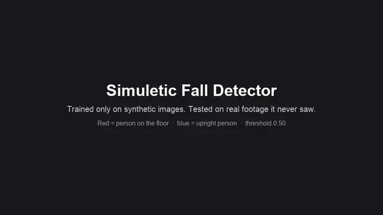
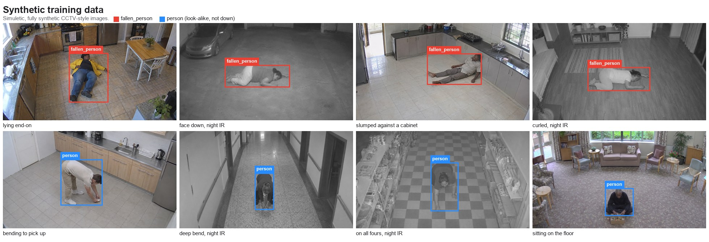
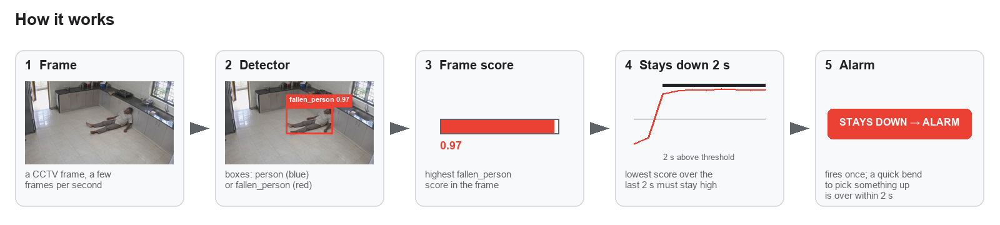
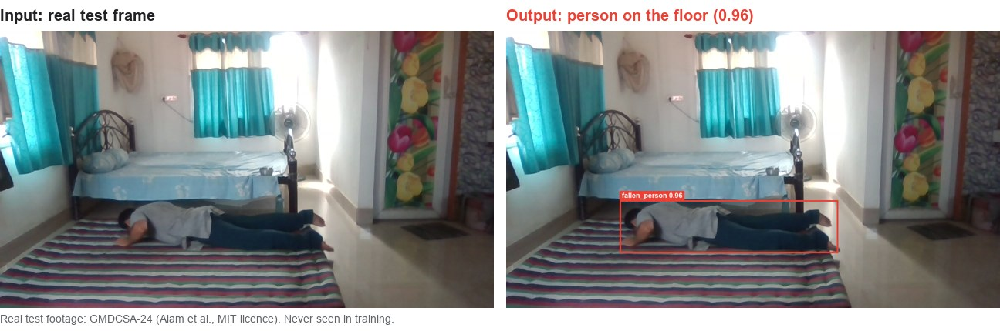

# Simuletic Fall Detector

**Detects a person lying on the floor after a fall, with a 2-second stays-down alarm.**

The model finds a **person lying on the ground or floor** (fallen, collapsed) in CCTV-style video, and tells them apart from
people who are standing, sitting, bending, kneeling or crouching. Trained **only on synthetic images**; tested on real,
staged footage from homes it has never seen.



*The release model on **real** test footage it never saw in training (GMDCSA-24, MIT; CAUCAFall, CC BY 4.0). Model: Nano (recommended). Clips are chosen by a fixed rule (the median-scoring fall in each test set, an everyday pick-up, and the hardest look-alike in the tests: a deep bend held for more than 2 s, which Nano correctly ignores and Small does not). Full video: [assets/validation.mp4](assets/validation.mp4).*



*Synthetic training data (Simuletic). Red = `fallen_person`, blue = `person`.*

- **Weights and model card:** [huggingface.co/Simuletic/fall-detector](https://huggingface.co/Simuletic/fall-detector) (D-FINE Nano, recommended; D-FINE Small; ONNX for both)
- **Try it:** [Hugging Face Space](https://huggingface.co/spaces/Simuletic/fall-detector) · [Kaggle notebook on a real test set](https://www.kaggle.com/code/simuletic/fall-detection-on-real-footage-trained-only-on-synthetic-data)
- **Licence:** **Code:** [Apache-2.0](LICENSE). **Model weights** (on Hugging Face and Kaggle): CC BY-NC 4.0, non-commercial research and evaluation only. See [Commercial use](#commercial-use-and-the-pro-model).

## Results on real footage (mean of 2 seeds, never the best one)

| | Small | **Nano (recommended)** |
|---|---|---|
| Test 1, CAUCAFall (one home): lying frames caught at 5% false alarms | 99.8% (99.7–100.0%) | 99.3% (99.0–99.7%) |
| Test 2, GMDCSA-24 (another home): falls caught at 10% clip false alarms | 96.8% (96.2–97.5%) | 94.5% (93.7–96.2%) |
| Stays-down alarm: falls caught with 0 false-alarm events | 60.4% (37.5–83.3%) | 100.0% |

For comparison, the same detector trained on real footage from one home caught 24% of falls in the other home.
Full tables, method and limits are on the [model card](https://huggingface.co/Simuletic/fall-detector).

## How it works



1. **Frame:** a CCTV frame, a few frames per second is enough.
2. **Detector:** D-FINE draws a box around each person, labelled `person` (upright) or `fallen_person` (on the floor).
3. **Frame score:** the highest `fallen_person` score in the frame.
4. **Stays down 2 s:** `StaysDownAlarm` keeps the lowest frame score over the last 2 seconds.
5. **Alarm:** it fires once when that stays above the threshold. A quick bend to pick something up is over within 2 s.

What one frame looks like going in and coming out (real test footage the model never saw):



## Install

```bash
pip install "git+https://github.com/Simuletic/fall-detector.git"
```

## Use

```python
from PIL import Image
from fall_detector import FallDetector, StaysDownAlarm

det = FallDetector()                  # D-FINE Nano (recommended) from the Hub; variant="small" for Small; onnx=True for ONNX Runtime
for d in det(Image.open("frame.jpg")):
    print(d.label, round(d.score, 2), d.box)  # label: "person" or "fallen_person"

alarm = StaysDownAlarm(threshold=0.5, seconds=2.0)   # fire only when someone stays down for 2 s
fired, persistent = alarm.update(t_seconds, det.frame_score(frame))
```

Command line, image or video:

```bash
python detect.py frame.jpg
python detect.py clip.mp4 --fps 5 --seconds 2
```

The video mode writes an annotated video, per-frame scores and alarm times. The default threshold (0.5) is a
starting point. Choose your own on footage from your cameras.

## The "stays down" alarm

A single frame of someone bending to pick something up can look like someone lying down from a high camera. A person
who has fallen stays down; a person picking something up is back up within a second or two. `StaysDownAlarm` keeps the
**lowest** frame score over the last N seconds and fires only when that stays above the threshold, so every frame in
the window has to agree. We report it next to the single-frame numbers, not instead of them.

## Reproduce the numbers

The evaluation scripts are the ones behind the model card. Download the two public test sets first:

| Test | Data | Licence | Get it |
|---|---|---|---|
| Test 1 | CAUCAFall, subjects 6 to 10 (single frames) | CC BY 4.0 | [Mendeley Data](https://data.mendeley.com/datasets/7w7fccy7ky) |
| Test 2 | GMDCSA-24, a different home (clips) | MIT | [GitHub](https://github.com/ekramalam/GMDCSA24-A-Dataset-for-Human-Fall-Detection-in-Videos) |

```bash
python eval/eval_caucafall.py --data "/path/to/CAUCAFall" --variant nano
python eval/eval_stay_down.py --data "/path/to/CAUCAFall" --variant nano
python eval/eval_gmdcsa.py --data /path/to/GMDCSA24 --variant nano
```

How they score:

- **Test 1:** the label is "is the person on the floor", not "is this the falling motion". Frames from one second
  either side of the fall onset are left out. Everyday clips (walking, hopping, sitting down, kneeling, picking up an
  object) are the negatives. We report recall when 5% or 1% of negative frames are allowed to alarm.
- **Test 2:** 2 frames per second; a clip's score is its second-highest frame score. Lying in bed or on a sofa is out
  of scope, so those clips are left out. We report falls caught when 5% or 10% of everyday clips are allowed to alarm.
- **Stays down:** Test 1 with the 2-second alarm, at frame level and at event level (24 falls, 34 negative events).

## Limitations

- The real test sets are **staged, small and indoor** (CAUCAFall: one home, 5 test subjects; GMDCSA-24: one home,
  4 people). Public spaces, crowds, long distances and real night-time infrared CCTV have not been measured.
- **Lying in bed or on a sofa is out of scope.** The model is not built or tested for it.
- The model looks at single frames. It does not see the fall itself, only someone who is down.
- Deep, long bends to pick something up off the floor are the hardest look-alike. See the model card for the measured
  false-alarm rates.
- This is a research model, not a medical device or a safety system. Do not rely on it to protect anyone.

## Training data

The model was trained only on synthetic CCTV-style images made by Simuletic: the
[CCTV Fall Detection dataset](https://simuletic.com/datasets?utm_source=github&utm_medium=readme&utm_campaign=fall-detector)
(free sample on [Hugging Face](https://huggingface.co/datasets/Simuletic/CCTV_Incident_Dataset_Fall_Lying_Down_Detection),
[Kaggle](https://www.kaggle.com/datasets/simuletic/cctv-incident-dataset-fall-and-lying-down-detection) and
[GitHub](https://github.com/Simuletic/cctv-fall-detection-dataset)) plus targeted top-ups: people lying end-on to the
camera or partly hidden by furniture, and look-alikes such as bending, kneeling and crouching. No real people and
no real footage were used for training.

## Commercial use and the Pro model

These weights are for non-commercial research and evaluation. For products, pilots or any commercial use, Simuletic
offers a **Pro model**: trained on 10k+ images (more night infrared, camera angles and look-alikes), edge builds,
a commercial licence, support, and optional fine-tuning on your own camera views.
Contact us at [simuletic.com/contact](https://simuletic.com/contact?utm_source=github&utm_medium=readme&utm_campaign=fall-detector).

## Credits

- Detector: [D-FINE](https://github.com/Peterande/D-FINE) (Apache-2.0), via Hugging Face `transformers`, started from
  the COCO checkpoints `ustc-community/dfine-small-coco` and `ustc-community/dfine-nano-coco`.
- Test sets: CAUCAFall (Eraso Guerrero et al., Data in Brief 2022, doi:10.17632/7w7fccy7ky, CC BY 4.0) and GMDCSA-24 (Alam et al., MIT). Used for evaluation only.

## Licence

Code: [Apache-2.0](LICENSE). Model weights: [CC BY-NC 4.0](https://creativecommons.org/licenses/by-nc/4.0/), non-commercial research and evaluation only. © Simuletic.
